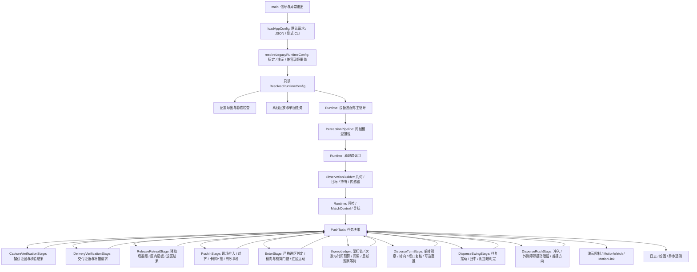

# 当前应用架构

本说明描述配置、入口、捕获与交付核验、释放后退区、现场推入决策、共享清扫账本、单转、往复摆动以及冲入与外侧避障摆动规划阶段提取后的实现。`PushTask` 的 `VERIFY_CAPTURE`、`VERIFY_DELIVERY` 分别委托给独立的 `CaptureVerificationStage`、`DeliveryVerificationStage`，`ReleaseRetreatStage` 管理释放后先退再推的私有历史及 `BACK_OUT` 决策，`PushInStage` 管理 `ENTER` 的现场推入分支，`SweepLedger` 管理跨清扫触发点的计时、次数和等待，`DisperseTurnStage` 管理清扫中单次转向的观察、转向、框口复核和可选直推，`DisperseSwingStage` 管理往复摆动、归中及附加趟判定，`DisperseRushStage` 管理冲入判定与外侧障碍摆动规划，`RecoveryStage` 管理兜底退区决策，`SearchStage` 管理搜索与接近，`SweepStage` 管理清扫状态机，`EnterStage` 管理严格进区判定，`DisperseClusterPlanner` 管理盲扫聚集选择，`CarryApproachStage` 管理假设搬运的视觉接近。清扫触发/收尾、`RAISE_RELEASE` 的反馈门控和公共运动许可仍在顶层，既有策略与状态名保持原样；R4 尚未完成，其余阶段按 `REFACTORING_PLAN.md` 逐批推进。

| 边界 | 文件 | 所有权与职责 |
| --- | --- | --- |
| 进程入口 | `src/main.cpp` | 安装退出信号，调用应用入口，统一异常状态码 |
| 请求加载 | `src/app/config_loader.cpp` | 严格 JSON schema，路径解析，文件与显式 CLI 优先级及来源 |
| 最终配置 | `src/app/runtime_config.cpp` | 复现历史覆盖顺序，聚合现有配置类型，导出参数、覆盖链与假设 |
| 生命周期 | `src/app/runtime.cpp` | 创建设备与比赛对象，保持每帧调用和运动发送顺序 |
| 视觉前端 | `src/app/perception_pipeline.cpp` | 检测/区域模型、共享 letterbox、原并行推理语义 |
| 观测构建 | `src/app/observation_builder.cpp` | 借用几何与传感器依赖，维护捕获、多视角、像素选择及无进展历史 |
| 离线分派 | `src/app/offline_tasks.cpp` | 原任务回放、几何回放和单图推理路径 |
| 诊断格式 | `src/app/diagnostics.cpp` | 原报告、区域绘制与单图诊断 |
| 任务协调 | `src/push_task.cpp` | 顶层门控、阶段转换、机构事务、黑名单、搬运计时与计分；尚未提取的阶段 |
| 捕获核验 | `src/task/capture_verification_stage.cpp` | 单视角确认、多视角结果、框内证据与非法类别重查；私有历史与类型化结果 |
| 交付核验 | `src/task/delivery_verification_stage.cpp` | 库存差值、独立帧与稳定窗口、视觉内外证据、定位等待；返回计分建议、补推请求与原事件文本 |
| 释放后退区 | `src/task/release_retreat_stage.cpp` | 私有先退再推模式、起始深度、区内确认计数与去重时间戳；返回继续后退、推入、核验或故障结果 |
| 现场推入 | `src/task/push_in_stage.cpp` | 对齐、保持航向、确认延长和探测脉冲的私有历史；返回运动请求、补推或完成结果及有序事件 |
| 共享清扫账本 | `src/task/sweep_ledger.cpp` | 清扫链的活动时间、单趟/整场统计、预算快照、间隔及重新观察等待；不执行清扫动作或切换状态 |
| 清扫单转 | `src/task/disperse_turn_stage.cpp` | 单转私有阶段、方向与视觉确认历史；返回运动请求、共享进度更新和原格式日志数据，不执行公共运动许可或切换顶层状态 |
| 往复清扫 | `src/task/disperse_swing_stage.cpp` | 摆动序号、当前趟与上限；返回摆动/归中运动请求、重设时钟或附加趟结果，共享起点与许可由父层应用 |
| 清扫冲入 | `src/task/disperse_rush_stage.cpp` | 待规划/已规划标记与左右摆动限幅；返回冲入运动、原因、完成与否及原 `[SWING_PLAN]` 数据，状态切换、账本与许可由父层应用 |
| 搬运规则 | `src/transport_rules.cpp` | 统一判定首趟、类别、数量与走廊约束 |

配置导出、静态检查和离线任务先于现场设备装配。单图任务只初始化推理所需资源；两类回放不创建现场设备。`ResolvedRuntimeConfig` 在补齐来源和运行身份后冻结，Runtime 与观测构建器只读引用，相关对象均在应用调用期间存活。

观测中的时间有意保留多个采样点：采集时刻的 `feedbackAt()` 与 `snapshotAt()`、方位拒绝判断的实时 IMU、动作 ACK、当前机构事务，以及帧尾实时健康信息。它们没有合并为一个快照。跟踪仍位于原调用位置，图像证据保存仍发生在原命令提交位置。

ObservationBuilder 借用 Runtime 创建的 GeometryPipeline、相机标定、区域颜色分类器、ControlledField 和 SensorFusion；维护自己的 CaptureMonitor、PixelSelector 与 MultiViewCapture。任务与上一输出以 const 引用提供查询，构建器不修改任务状态。预检写入最终运行许可，导航写入路线信息，随后 PushTask 读取观测。

## 捕获核验阶段

`CaptureVerificationStage::update()` 只读接收 `PushObservation`、`TaskTuning` 和包含阶段经过时间、目标标签、待捕获清单、首趟完成标记的上下文。阶段不保存这些引用；复制或移动 `PushTask` 时，其核验历史按值独立保存。现阶段继续沿用已有观测和调参类型，未引入通用阶段框架。

阶段独占单视角连续确认、上次清单、框内可见帧、目标出现帧、非法内容连续帧，以及类别重查的目标 ID、强置信帧、消歧帧和起始时刻。其他状态使用的 `confirmations_`、`seen_` 仍由顶层持有，不与阶段共享。

返回结果为 `Continue`、`Verified`、`Assumed`、`CaptureFail`、`AbortDrop` 或 `SafeStop`，附带接受的清单、可选规则判定、原因和黑名单请求。缺少判定或原因更新时保留上一条任务诊断。阶段不切换顶层状态、不提交机构或运动命令、不修改交付统计。顶层按原顺序应用诊断、黑名单、转换与搬运计时，仍由 `transport_rules` 判定清单合法性。

通过 `enter()` 进入、重新进入或离开 `VERIFY_CAPTURE` 时清空核验历史，`clearTrip()` 也清空历史。暂停仍先进入 `WAIT_START`，恢复按原路径进入 `ABORT_DROP`；不可恢复故障仍直接进入 `SAFE_STOP` 并保留原阶段时刻，随后显式 reset 才开始新任务。阶段只在公共许可通过后调用，保留 `VERIFY_CAPTURE` 原有的俯仰等待豁免。

兼容行为包括：严格多视角超过 8 秒先停机，即使该帧出现有效摘要；恰好 8 秒仍可成功。现场假设捕获与实测冲突的处理顺序、非法类别重查优先级、仅假设捕获清零搬运进度，以及失败转换当帧保持闭框、下一帧再释放，均有回归覆盖。完整验证结果见 [重构进度](REFACTORING_PROGRESS.md)。

## 交付核验阶段

`DeliveryVerificationStage` 独占计数确认帧、增量、上次区域帧、稳定窗口、视觉内外计数、远俯仰请求、首次定位时刻和货物时间戳。它读取观测、配置、顶层锁定的基线/半区/清单/补推次数，以及顶层通过既有几何函数求得的 `DeliveryCargoEvidence`。阶段不保留输入引用，也不更新货物跟踪器。

输出只有 `Continue`、`Repush`、`Complete` 三种结果，附带建议计入数量、视觉核验标记、原因和原格式事件文本。顶层执行补推次数累加、进入 ENTER、框动作、总分累加、首趟完成许可和演示停机。补推次数仍与 ENTER 的卡停重试共用同一预算；区域定位、货物选择和半区锁定继续使用原函数。

交付阶段按原生命周期分项清理，不能像捕获阶段一样在每次进入时清空整个对象：

| 触发点 | 清理项 | 保留项 |
| --- | --- | --- |
| 任意 `enter()`，含暂停后恢复核验 | 计数确认帧 | 库存增量/窗口/帧号、视觉计数、定位时刻、远视图和货物时间戳 |
| GATE 成功建立新库存基线 | 库存增量、帧号、稳定窗口 | 视觉历史；确认帧仍按原阶段转换清理 |
| BACK_OUT 判定释放后已在区内 | 视觉内外计数 | 定位时刻、远视图和货物时间戳 |
| 核验请求补推 | 视觉内外计数、远视图、首次定位时刻 | 库存窗口、帧号、货物时间戳；随后 `enter()` 清确认帧 |
| 核验完成 | 远视图、首次定位时刻 | 其他证据；后续阶段按各自入口处理 |
| `clearTrip()`，含显式 reset | 视觉内外计数、远视图、首次定位时刻 | 库存窗口、帧号、货物时间戳；reset 随后的 `enter()` 清确认帧 |

这里保留跨趟/显式 reset 的去重时间戳是兼容行为，不代表新增的清理策略。修改这些规则需要单独的策略变更。独立区域帧沿用“与上一帧 ID 不同”的判断，并未新增全局唯一或单调递增要求；达到确认帧数后，重复帧仍可满足已经开始的 300 毫秒窗口。

库存核验要求正确几何、完整计数、另一半计数不变、增量不超出本趟清单、开框反馈和入口退出位置。稳定库存证据优先于视觉判断；视觉外部证据触发的补推优先于超时结算。视觉通过仍不自动计分：`field_carry` 在缺少稳定库存且未启用 `assume_all_safe` 时结束核验但计入 0；假设模式的整趟记入行为保持原样。视觉确认阈值继续使用此前跟踪的 `cargo_fix_`，不改成当前帧定位标记。

远视图请求仍交给顶层 `desiredPitch()` 和公共相机门控；相机未到位时不调用阶段。阶段输出事件保持旧日志格式与次序，包含补推前的证据计数和补推后的清零计数，顶层只追加到已有事件缓冲。

## 释放后退区阶段

`ReleaseRetreatStage` 独占先退再推模式 `prepush_`、起始持有位置深度 `start_hold_y_`、释放后区内确认计数和上次货物时间戳。`RAISE_RELEASE` 确认释放后通过 `beginReleaseBackOff()` 开始该模式；`PushInStage` 判定卡停补推后，顶层通过 `beginRepushBackOff()` 开始补推前后退。`BACK_OUT` 在机构反馈通过后调用退区阶段；现场推入、对齐与卡停判定由推入阶段处理。

阶段显式读取配置，以及经过时间、已行驶距离、当前严格区域观测、入口是否退出、锚定区域是否可用、当前持有深度、目标后退距离、运动比例、盲退标记、共享补推次数和目标半区位置。货物输入 `ReleasedCargoEvidence` 包含父层跟踪后得到的可见性、定位标记、裁切标记、后沿坐标和时间戳。阶段不保留输入引用，私有历史按值持有。

输出为 `Continue`、`PushIn`、`VerifyDelivery`、`InsideAfterRelease` 或 `Fault`，附带原因、是否请求后退和是否锁定盲退路径。父层保留释放时的对手区域许可、相机与开框反馈门控，货物跟踪与几何计算，运动命令及其公共许可，`enter()`/`fail()`、补推次数、推入阶段准备、计分和事件缓冲。在 `BACK_OUT` 中，只有先退再推模式在相机与开框反馈通过后调用 `trackCargo()`；阶段内不追踪货物或提交运动。释放后已在区内的事件仍先记录交付阶段原有视觉计数，再清空这些计数并进入交付核验。

退区历史按原赋值位置清理：

| 触发点 | 更新或清理项 | 保留项 |
| --- | --- | --- |
| `beginReleaseBackOff()` | 启用先退再推，更新起始深度，清区内确认计数 | 上次货物时间戳 |
| `beginRepushBackOff()` | 启用先退再推，更新起始深度 | 区内确认计数和上次货物时间戳 |
| 任意 `enter()`，含暂停与恢复 | 父层重置阶段经过时间的起点、行驶距离和盲退标记 | 退区阶段模式、起始深度、区内计数和去重时间戳 |
| `clearTrip()`，含显式 reset | 清先退再推模式、区内计数和货物时间戳 | 起始深度；下次开始后退时覆盖 |

先退再推阶段优先检查释放后的区内证据：必须补推次数为零、货物可见且有定位、未裁切、后沿深度及半区位置达标，并累计与上次接受值不同的货物时间戳，不要求全局唯一或单调递增。满足后直接进入交付核验；否则再检查后退距离与超时。可用的锚定区域允许使用预测位姿，以起始深度减当前深度判断后退距离；没有锚定区域时使用行驶距离与运动比例。这与普通严格退区所需的当前可信区域观测不同：预测区域不能单独证明入口已经退出。

先退再推的距离或超时满足后进入 `ENTER`，超时不记为退区故障。普通退区在现场搬运或假设模式下可锁定盲退路径，以限定行驶距离进入核验；否则等待当前区域观测证明入口已退出。盲退距离达标或严格入口已退出均优先于超时。普通退区超过预算时停机：盲退未达标或已有区域观测但入口未退出时为 `retreat_blocked`，严格路径缺少区域观测时为 `retreat_reference_lost`。距离比较保留 `>=`，时间比较保留 `>`；相机、开框和释放许可超时仍由父层处理。

## 现场推入阶段

`PushInStage` 只接收 `ENTER` 中 `carryLogic() && !assume_pushed_` 的分支；`carryLogic()` 为 `assume_all_safe || field_carry`。现场路径中已经标记推入完成后的原分支继续由父层处理；严格进区判定由 `EnterStage` 处理。父层先通过公共相机门控、闭框命令与反馈，再调用 `trackCargo()`，使用已有几何函数构造输入，随后调用阶段。阶段不更新跟踪器、不读取设备，也不直接切换顶层状态。

阶段按值独占以下私有字段：

| 字段 | 含义 |
| --- | --- |
| `align_pending_`、`align_start_us_` | 是否等待推入对准及对准起始时刻 |
| `push_hold_valid_`、`push_hold_phi_` | 货物丢失后是否保持最后推入航向及该航向 |
| `probe_until_us_`、`probe_next_us_`、`probe_sign_` | 探测脉冲截止时刻、下次开始时刻和交替方向 |
| `enter_unconfirmed_` | 本趟是否已因进区证据不足延长推入并记录事件 |

`PushInContext` 显式提供当前时刻、阶段经过时间、行驶距离、IMU 阻塞时长、锚定区域可用性、持有位置与区域朝向、目标半区、持有中心、视觉定位最近接受时刻和共享补推次数。`PushInCargoEvidence` 提供跟踪后的货物可见性、定位与裁切标记、后沿及机体坐标、最近可见时刻和静止参考时刻。阶段不保留输入引用；几何预计算仍在父层，沿用原函数与同帧数据。

输出为 `Continue`、`Repush` 或 `Complete`，附带原因、清货物静止参考的请求、运动请求和有序事件。父层应用清参考请求；若为补推，先增加共享补推次数，再按原序分发 `Cargo`、`DropZone`、`Text` 事件，分别调用已有日志函数或追加原格式文本。随后应用阶段原因，需要运动时再调用公共 `drive()`，保留方向许可对原因和运动的覆盖。补推后退、推入完成后的释放转换、`assume_pushed_` 和计分均由父层应用。

| 触发点 | 更新或清理项 | 保留项 |
| --- | --- | --- |
| 先退再推结束或交付核验请求补推时调用 `prepare(align)` | 按配置设置 pending，清对准起始时刻和保持航向有效标记 | 航向值、探测时序与方向、未确认延长标记 |
| `clearTrip()`，含显式 reset | 清 pending、对准时刻、保持航向有效标记、延长标记与探测时刻；探测方向置 `1.f` | 航向值；在有效标记为 false 时不使用 |
| 任意 `enter()`、暂停与恢复 | 父层按旧路径重置阶段起点、行驶距离和盲退标记 | 推入阶段全部私有历史；从 `ENTER` 暂停后仍恢复到 `BACK_OUT` |

推入先判断货物已在区内、深处阻塞、卡停，再处理对准、深度和超时完成。尚有预算的卡停补推优先于超时完成；补推预算耗尽时直接结束推入，不进入确认延长。对准状态使用本帧开始时的快照：该帧清货物静止参考并抑制卡停判定，即使对准在同帧结束。对准转向会在区域深度判断前提前返回；其预算使用 `<`，恰好到期不再等待转向，按原证据记录对准结果并继续。

确认延长沿用当前货物与持有深度的不同证据门槛：缺少锚定深度时，独立货物进区证据仍使用原 `1e9f` 哨兵；卡停补推的无锚定起点为 `0.f`。最终可见货物确认不额外要求定位标记。延长首次只记录一次货物未确认事件，随后记录区域事件；迟到确认或达到额外时间/最大深度限制后，先记录对应货物事件，再记录完成区域事件。阶段超时仍使用 `>`，延长时间与深度上限仍使用 `<`。

视觉追踪沿用原斜推、横向死区、夹限及补推速度增益；启用对准推入且保存过有效航向时，货物超过追踪新鲜度后保持最后航向。货物可见性窗口为 1500 毫秒，对准和追踪新鲜度为 400 毫秒，视觉定位的新鲜度也单独判断。追踪误差继续使用未额外归一化的 `bearing + slant`，保持航向时才按区域朝向归一化；没有锚定区域时按原行驶距离和基础推入速度盲推。

探测只在满足原延迟、当前转向为零且不再等待对准时生成短时交替转向。首个脉冲先翻转方向；普通转向只取消当前脉冲，不重置下次开始时刻或方向。阶段历史更新发生在父层 `drive()` 许可判定前，即使运动被拒绝也保留原来的更新行为。

## 共享清扫账本

`SweepLedger` 按值独占 11 个原私有字段：单趟已完成次数、单趟和整场已结算时间，清扫链起点、活动段起点、累计活动时间、暂停时刻、活动标记和摆动标记，以及清扫间隔与重新观察的截止时刻。它读取显式传入的 `TaskTuning` 和时刻，不保存配置引用。单转动作的私有历史由 `DisperseTurnStage` 管理；共享动作计时、目标确认、尝试次数、散开/堆料冷却、框动作和运动执行继续由 `PushTask` 管理，账本不执行动作。

`begin()` 先结算超过链接窗口的暂停链，再建立或恢复活动段。`pause()` 只累计当前活动段，不结算次数；`close()` 将累计活动时间各计入单趟与整场一次，只有设置过摆动标记才增加次数。摆动标记沿用进入摆动阶段时设置的语义，不证明底盘已经执行转向；PILE 仍可在没有打开清扫链时更新该标记。暂停链接间隔不计入活动时间，但整链操作预算仍从最初起点按经过时间判断。

| 触发点 | 更新或清理项 | 保留项 |
| --- | --- | --- |
| 显式 `reset()` | 清单趟/整场统计、链起点与累计值、活动/摆动标记、间隔及重新观察等待 | 已失效的活动段起点与暂停时刻；无链时不读取它们 |
| TURN_SCAN 完成后 `newTrip()` | 先关闭链，再清单趟次数、单趟时间和间隔 | 整场时间、重新观察等待 |
| `clearTrip()` 或任意 `enter()` | 不调用账本重置或暂停 | 全部账本历史 |
| 远组接近完成 | 暂停活动链，等待近距离清扫衔接或链接窗口过期 | 链起点、已累计活动时间与摆动标记 |
| 操作员停机、安全/健康检查提前返回 | 保持原提前返回顺序，不新增账本暂停 | 活动链可能在恢复后计入这段经过时间 |

每次可继续决策的更新仍先关闭已经离开清扫动作的活动链，再结算过期暂停链，最后生成一次只读 `SweepBudgetState`，包含时间许可、次数/时间许可、含间隔的完整许可、操作超时、清扫终止和升级次数。该快照在相机等待与重新观察门控之前生成，当帧后续动作不重算预算。各触发点仍使用原许可组合：非补给清扫只检查时间，dense multi 可按配置忽略间隔，普通清扫检查完整许可。

清扫间隔与重新观察等待分别维护。`close()` 在启用观察保护时请求重新观察，即使该链没有摆动；它与自动结算均不设置间隔。父层在原结束路径设置间隔，PILE 使用延长到两者最大值，SCATTER 提前看见目标且尚未摆动时保留例外，直立清扫的结束间隔仍受观察保护开关约束。

相机等待通过 `extendObservationWait()` 续期任何非零待观察时刻，包括已经过期的时刻。只有 `SCAN`、`APPROACH`、`MID_APPROACH`、`MID_REACQUIRE` 在公共框反馈之后调用 `waitForObservation()` 消费等待；未到期时父层停车并输出 `sweep_reobserve`，到期清除等待，关闭观察保护时保留原待观察时刻。

比较边界、零哨兵及无符号运算保持原样：链接间隔相等时仍可续接，操作时间相等尚未超时，时间预算或次数达到上限则不可启动，间隔截止相等可启动，观察截止相等结束等待。`PushTask` 的 `sweepDone()`、`sweepSpentUs()`、`sweepChainOpen()` 继续委托账本提供原诊断查询。源码等价性审查及本批验证记录见 [重构进度](REFACTORING_PROGRESS.md)。

## 清扫单转阶段

`DisperseTurnStage` 处理共享 `disperseStep()` 中原 `disperse_turn_phase_` 非零的分支。清扫冲入结束时，父层按 `disperse_single_turn && !disperse_small_` 启用阶段；SCATTER、APPROACH 和 PILE 继续共用该路径。阶段按值独占六个字段：当前阶段、清空确认计数、转向方向、相机到位后观察起点、框口上次接受的帧时刻和进入框口复核时的转角。

MID_APPROACH 的非补给清扫也可能启用单转，但父层的单转相机档位覆盖和观测丢失豁免仍只包含原有状态集合，不扩展到 MID_APPROACH。这一差异保留为兼容行为，不在本轮统一。

`DisperseTurnContext` 显式提供当前时刻、共享动作起点、当前/起点里程、共享起始航向、运动比例、预定方向、相机是否到位、中间俯仰档位是否可用及左右摆动上限。阶段读取 `PushObservation` 与 `TaskTuning`，不保存输入引用。结果包含继续或完成、转向或直推请求、原因、开始转向/开始直推事件和框口日志数据。

父层继续管理 `sweep_phase_`、`sweep_start_us_`、`sweep_yaw0_`、`sweep_travel0_`，清扫账本、冲入阶段提供的摆动限幅、开框反馈及公共相机门控。阶段先读取上下文，在同帧内部使用开始转向后的新航向和时刻；父层随后应用转向与直推起点事件，输出原 `[TURN] frame_zone` 日志，设置原因并调用公共 `drive()`。快速转向的角速度覆盖仍只在 `drive()` 已允许非零角速度后发生，保留运动被拒绝时的停车和原因覆盖。阶段完成后的冷却、计次、重新观察和顶层状态切换仍由原调用点处理。

阶段顺序为 `Look`、`Turn`、可选 `FrameCheck`、可选 `Push`；`Idle` 表示未启用或已经结束。Look 等待相机到位及该时刻之后的新鲜观测，随后向物块较少一侧转向，平局或等待到期使用预定方向。Turn 沿用左右视区计数及最小转角，受规划转角和预算限制。FrameCheck 先检查总转角、额外转角与预算，再等待低俯仰相机和框口证据；缺少首帧时有界等待，已经取得清空证据但尚不足帧数时停车确认。可选直推在下次更新开始请求运动，不在转向结束当帧直推。

普通 Turn 仍可重复累计同一新鲜观测；FrameCheck 要求时间戳与上次接受值不同，不新增单调递增要求。新鲜度边界为 `<=`，最小/最大转角和直推距离达标使用 `>=`，动作预算超时使用 `>`，观察等待恰好到期即可结束。零时刻哨兵和原无符号时间运算保持原样。

| 触发点 | 更新或清理项 | 保留项 |
| --- | --- | --- |
| `begin(enabled)` | 设置 Look 或 Idle，清观察起点和确认计数 | 方向、框口去重时刻和框口起始转角；对应分支再次进入时覆盖 |
| 进入 FrameCheck | 清观察起点、框口去重时刻和确认计数，记录当前转角 | 转向方向及父层共享动作起点 |
| 任意 `enter()`，含暂停、恢复和显式 reset | 仅调用 `cancel()` 将阶段置 Idle；父层清共享清扫动作阶段 | 其余五项私有历史 |
| `clearTrip()` | 不调用阶段重置；父层清共享清扫动作阶段 | 阶段全部私有历史 |
| PILE 建立下一轮冲入 | 仅调用 `clearConfirmation()` | 当前阶段及其余历史；冲入完成后 `begin()` 按旧路径重设 |

清扫触发与结束策略仍在顶层。冲入与外侧障碍规划、往复摆动与附加趟判定、兜底退区、搜索与接近、清扫状态机、严格进区判定、盲扫聚集选择及假设搬运视觉接近已在后续批次独立提取，见下文各节。

## 往复摆动与归中边界

`DisperseSwingStage` 处理 `disperseStep()` 中单转未激活时的往复摆动、归中及下一趟判定，四个调用状态仍为 SCATTER、APPROACH、MID_APPROACH 和 PILE。阶段按值独占原摆动序号、当前趟号、总趟数及总摆数四项，不保存配置引用；父层传入共享时刻、航向、里程、运动比例、小清扫标记、摆动方向、外侧障碍上限与快速摆动资格。

阶段返回 `Continue`、`NextPass` 或 `Complete`，以及可选运动请求和重设摆动时钟事件。冲入完成同帧调用 `beginSwing()`，随后立即计算第一摆；达到摆动目标或超时只增加序号并重设父层时钟，当帧不赋原因、不请求运动。归中后先增加趟号；仍有下一趟时父层设置额外冲入距离、翻转方向并重设冲入阶段/时钟/里程，当帧不冲入。末趟完成仍交各原调用点处理计次、冷却、重新观察、非补给排除、PILE 续链或 SCATTER 后退。

角度由原 `wrapAngle()` 计算，摆动目标容差和归中容差分别保留；当前帧方向仍由 `goal > dyaw` 决定，越过目标后可能反转，不在结构提取中修改。动作预算使用 `>`，慢速前移距离使用 `<` 并乘原运动比例；归中不受摆动角度上限约束，也不慢速前移。阶段原因先交父层，再经过 `drive()` 的原许可门控，只有输出角速度非零时才应用快速角速度覆盖。

| 触发点 | 更新项 | 保留项 |
| --- | --- | --- |
| 构造 | 摆动序号/趟号 0，总趟数 1，总摆数 6 | 与原字段默认值相同 |
| 近 SCATTER、密集/非补给清扫、小清扫触发 | `configure(passes, swings)` 清趟号并设置对应上限 | 摆动序号，冲入完成时才清 |
| 每次冲入完成 | `beginSwing()` 只清摆动序号 | 趟号和上限；单转路径不消耗趟号 |
| PILE 建立下一轮冲入 | `beginSwing()` 和 `restartPass()` 清两种序号 | 上次总趟数/总摆数，保持旧继承行为 |
| `enter()`、`clearTrip()`、暂停/恢复、显式 reset | 不额外重置阶段 | 全部四项历史；父层仍按原路径清共享动作阶段 |

公共框反馈、相机等待、缺观测/航向守卫、整链预算继续留在父层，冲入与外侧障碍规划见下节；MID_APPROACH 与其他状态原有的观测豁免差异保持原样。验收记录见 [重构进度](REFACTORING_PROGRESS.md)。

## 冲入与外侧避障摆动规划阶段

`DisperseRushStage` 处理 `disperseStep()` 中 `sweep_phase_ == 4` 的冲入，以及原 `planSwing` lambda 的外侧障碍限幅规划。SCATTER、APPROACH、MID_APPROACH 与 PILE chain 四个调用状态仍共用同一路径。

阶段按值独占原外侧规划四项：待规划标记、已规划标记和左右限幅。父层保留 `sweep_phase_`、清扫时钟与起始航向/里程、冲入距离、清扫账本、首摆方向的应用、单转与摆动起始、框与相机门控及公共运动许可。

`DisperseRushContext` 显式提供当前时刻、冲入起点、当前/起点里程、运动比例、冲入距离、聚类范围、是否 SCATTER、快速摆动资格、远视角判定与俯仰就绪、聚类新鲜度，以及是否有锁定目标及其机体系位置。阶段读取 `PushObservation` 的聚类点，不保存输入引用。

输出为 `Continue` 或 `Complete`，附带冲入速度、原因（`disperse_rush` 或 `first_burst_impact`）与规划事件数据（外侧对象数量、左右限幅、首摆方向）。规划条件为开关开启、处于 SCATTER 且聚类新鲜；远视角判定开启时需 `pitch_cmd_ == far_pitch_cdeg`，否则延迟到完成帧再规划。父层应用首摆方向并原样打印 `[SWING_PLAN]`；完成帧父层按原次序设置摆动阶段、时钟、航向与里程、账本摆动标记和单转起点。

速度沿用原表达式：首冲满冲击只在 SCATTER 且快速摆动资格成立时使用 `first_burst_speed`，否则使用 `disperse_speed`；`drive()` 通过后仍用未截断速度覆盖 `vx`，保留全部净空否决。行程达标使用 `>=` 并乘运动比例，预算使用严格 `>`；完成帧不请求运动。

生命周期：`beginSweep(pending)` 用于清扫起点（设置待规划标记并复位限幅），`clear()` 用于非 SCATTER 的 `enter()`（清四项），`clearFlags()` 用于 PILE 续链（只清两个标记、保留限幅值，与原字段行为一致）。`clearTrip()`、暂停恢复与显式 reset 不额外清阶段历史。

| 触发点 | 更新或清理项 | 保留项 |
| --- | --- | --- |
| 清扫起点 `beginSweep` | 待规划标记设为配置值，已规划标记清零，限幅复位 99 | — |
| 规划发生 | 待规划标记清零，写入限幅并置已规划 | 首摆方向由父层应用到共享方向 |
| 冲入完成 | 不改阶段 | 全部四项，供摆动与单转读取 |
| 非 SCATTER 的 `enter()` | 清两个标记与限幅 | — |
| PILE 续链 | 只清两个标记 | 左右限幅值 |
| `clearTrip()`、暂停/恢复、显式 reset | 不额外重置 | 由后续 `beginSweep` 或 `enter()` 按原路径处理 |

## 设备与后续范围

设备声明顺序保留：MotionLink 先于 UART 和 MatchControl 析构，其许可回调不会引用已销毁的比赛对象。链路仍按 25 Hz 重发、150 ms 指令过期归零、首次提交前不发送，停车保留机构目标。已有协议测试覆盖这些语义；本轮没有改变采集线程或协议。

主程序遥测链路是 `TelemetryPublisher -> /dev/shm/快照 -> tools/remote_camera_telemetry/project_bridge.py`。旧平铺 `config` 字段保留，新增 `config.effective` 与命令行导出使用同一个序列化器。`foxglove_telemetry/` 是独立工程，不是当前主程序的发送实现。

当前兼容版本仍在观测内部保留部分原算法常量、无进展放宽和日志节流；它们不是 schema v1 的可调项。严格策略、完整观测记录回放、其余阶段私有状态和脚本迁移仍需后续验收。本地合成测试不覆盖真实模型耗时、现场传感器时序或实车结果。前批 [cat 主机验证](validation/CAT_HOST_20261020.md) 覆盖 ARM64 构建、真实 RKNN SDK 和保存图片；本轮 [相机短跑](validation/CAT_CAMERA_20261020.md) 只使用已有 R4-six 二进制，无串口输出，不能代替传感器、机构或实车验收。

本轮发现主机 EXT4 数据丢失告警、C++ 前端包摘要不符、tmpfs 输入非预期变化和多次编译器内部错误，已停止新批 ARM/相机验收；详见 [异常记录](validation/CAT_SWING_20261020.md)。后续已用官方签名精确版本包确认 `cc1plus` 的 7 字节差异，补齐 ignored 模型/运行库及启动资源备份；用户暂时无法现场操作，主机尚未离线恢复，详见 [完整性与恢复记录](validation/CAT_INTEGRITY_20261020.md)。主机恢复后必须从可信源码重新验证，不能把本机阶段回归或旧 ARM 结果视作新批部署资格。

## 假设搬运视觉接近

`CarryApproachStage` 接管 `CARRY` 中已锚定区域时的视觉闭环：沿区域中轴追踪前视点接近区前沿，判定到达释放间隙、卡滞或 IMU 受阻。区域位姿预计算、`lockDropHalf()`、`vref_used_`/`zone_search_started_us_` 写入、漏帧与半区锁定、`drive()`/`steer()` 的公共运动许可、`noteDropZone()` 记录和状态切换全部留在父层。

阶段独占两项原先由父层持有的历史：卡滞进度时刻 `progress_us_` 与最好深度 `best_y_`。父层原有的三处清零（显式 reset、暂停恢复、假设捕获交接）改为调用 `reset()`，只清进度时刻，深度在下一帧按原 `!carry_progress_us_` 分支刷新，语义与修改前一致。

`CarryApproachContext` 按值提供当前时刻、区域坐标下的持有中心、已转换到机体系的区域前视点、视野是否新鲜、IMU 受阻时长与持有中心。判定顺序照搬：先按 `assume_stall_progress_m` 刷新进度；IMU 受阻（时长达标且已到前沿附近）或新鲜视野下的卡滞优先返回 `RaiseRelease` 并带上对应的 `release_stall_imu`/`release_stall` 事件名与原因；随后单独的到达释放间隙返回 `RaiseRelease`（事件名 `release`，原因区分新鲜视野与推算）；都不是则给出前视航向，并在离前沿较远且需要大角度时标记边走边转，否则由父层用 `steer()` 决定是否原地对正。

## 盲扫聚集选择

`DisperseClusterPlanner` 承担原先内联在 `update()` 的 `isOrdinary`/`findBest`/`evalGroup` 三个 lambda：在聚类点中挑选最密集且最朝向正前方的组，并决定触发短窗清扫还是先靠近。所有状态都是每 tick 的：父层在每次 `update()` 中按值构造一个规划器，`ord_extra`、最优数量、中心与距离都不跨帧保留，与原局部变量生命周期一致。

`findBest()` 保留原筛选与打分：跳过非有限点、近/远距离窗口外、横向半宽外和方位角外的点；以 `radius` 内的点计数求质心，分数为 `n - 2*|bearing|`，同分时取更近的质心。配置 `blind_scatter_need_ordinary` 时，组内必须有普通物资点，`clutter_ordinary` 与父层追加的锁定/弱检测点都计入。`evalGroup()` 保留原规则：`need_n`/`far_need` 大于 1 时按清扫升级数递增，短窗未达标且远窗启用时改用 `blind_scatter_far_radius_m` 再试，命中远组才返回 2，其余返回 0 并清除最优组。

父层仍负责所有写操作：`beginScatter()` 通过 `bestCentre()`/`bestDistance()` 读取保留的组，清扫方向、距离、冷却、账本开始与状态切换都留在顶层；`SearchStage`/`SweepStage` 通过既有服务回调注入 `find_best`、`eval_group`、`add_ordinary_extra`，调用顺序不变。

## 严格进区阶段

`EnterStage` 处理 `ENTER` 中 `carryLogic() && !assume_pushed_` 之外的分支，即观察已确认持有货物后的进区判定：区域内持有中心越过投放线、横向偏差超限、进区超时，以及区域失效后的分派。父层先完成相机门控与闭框反馈，再调用阶段；阶段不读取设备、不执行运动许可检查，也不直接切换顶层状态。

阶段输入 `EnterContext` 显式提供阶段经过时间、区域是否可用、父层已判定的目标丢失标记、是否处于假设搬运、是否已锁定投放点及其纵坐标、机体持有的中心点在区域坐标下的位置、目标半区位置和进区航向误差。`EnterResult` 返回类型化结果 `Continue`/`RaiseRelease`/`AbortDrop`、原有原因串、是否复位父层漏帧计数，以及可选的进区速度与角速度。

判定顺序与旧实现一致：区域不可用时先看目标是否已丢失（否则当帧不动），丢失后在假设搬运下转入 `RAISE_RELEASE` 并记 `assumed_drop_point_zone_lost`，否则转入 `ABORT_DROP` 并记 `zone_lost`；区域可用时先复位漏帧计数，再依次比较投放线、横向偏差和进区预算。投放线使用锁定投放点纵坐标（未锁定时取配置目标），比较保留 `>=`；横向偏差取绝对值并保留严格 `>`；预算比较保留严格 `>`。三项均未触发时输出 `enter_speed` 与 `heading_gain *wrapAngle(z) + lateral_gain * lateral` 的角速度，由父层经公共运动许可后执行。
